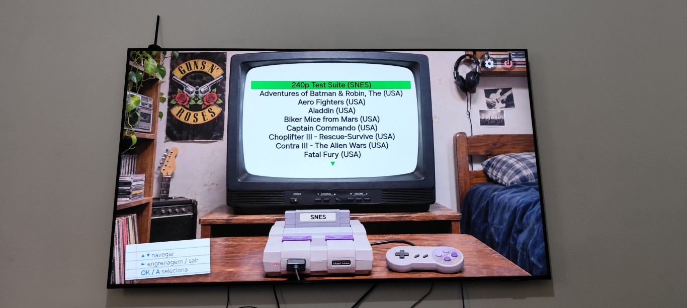
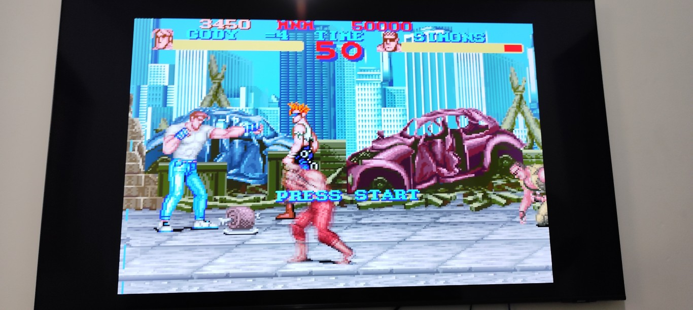
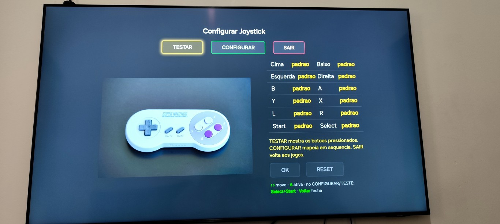
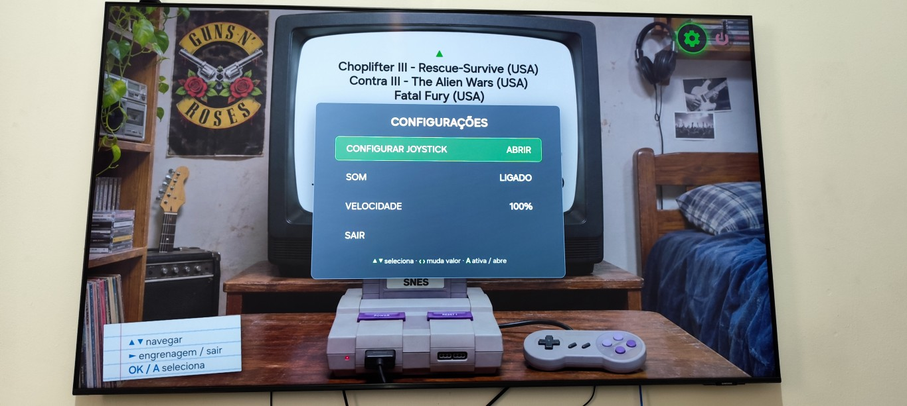
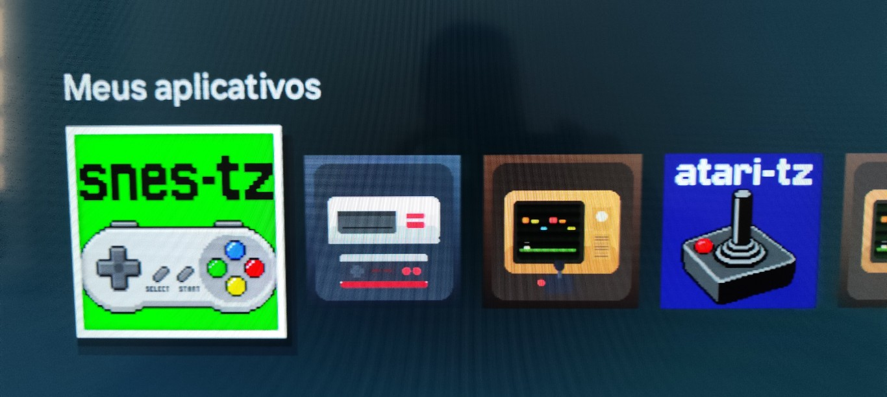

# 🎮 SNES Emulator for Samsung Smart TV (Tizen)

Play **Super Nintendo (SNES)** games on your **Samsung Smart TV**. A self-contained web app (`.wgt`) you **sideload** onto the TV, running the **snes9x2005** core compiled to **WebAssembly** at full speed on the TV's modest SoC. Launches from the [lilauncher](https://github.com/mendes79/lilauncher) home screen or straight from the TV's app list.

> No root. No native binary. Just the TV's own WebView. Not affiliated with Nintendo or Samsung.

|  |  |
| :---: | :---: |
|  |  |
| _Full-speed gameplay (snes9x2005 in WASM)_ | _Interactive joystick configuration_ |
|  |  |
| _Settings: sound and speed presets_ | _Launches from the lilauncher home screen_ |

## ▶️ Demo

<!-- TODO: cole aqui o link do vídeo de demonstração no YouTube. Ex.: [Watch the 60s demo](https://youtu.be/SEU_VIDEO) -->
_Demo video coming soon._

## Why this exists

Samsung's 2022 Tizen TVs ship a locked-down Chromium M85 web engine, no SIMD and no WebAssembly threads. Most emulator builds simply refuse to validate or crawl. This project ships a **lean, single-thread, scalar WebAssembly build** of snes9x2005 that actually runs full speed on that engine, wrapped in a TV-friendly UI you drive with a gamepad.

## What it is

- Target device: Samsung 65BU8000 (2022, Crystal UHD), Tizen 6.5, web engine Chromium M85.
- Core: snes9x2005 recompiled to a lean single-thread scalar WebAssembly module (no SIMD, no threads), so it validates and runs on the old Chromium M85.
- Delivered as a Tizen `.wgt` package. It is the same WebView used by the TV browser, so there is no native binary on the app side.

## Features

- Full-speed emulation on the target TV (validated with an honest speed meter: emulated frames per real second, not nominal FPS).
- Game selection screen rendered over a themed wallpaper, with vertical navigation and a settings panel.
- Settings: sound on/off and speed reduction presets (100%, -6%, -8%, -10%), persisted locally.
- Interactive joystick configuration: a guided wizard maps each button, with a live controller diagram that highlights the pressed button.
- Controller: 8BitDo Ultimate 2.4G (USB HID dongle) via the Gamepad API. Select+Start returns to the carousel from a game.
- Catalog split: private commercial ROMs stay local and are never published; freely distributable ROMs ship in `roms_pub/`.

## Included free ROM

- 240p Test Suite (SNES) by Artemio Urbina, GNU GPL v2. A video test suite that also works as a free test ROM for the emulator. See `roms_pub/CREDITS.md`.

## Repository layout

- `index.html` plus `js/` : the application (UI, input, audio, HUD, libretro frontend adapter).
- `js/snes9x2005.wasm` / `js/snes9x2005.js` : the compiled core.
- `core/` : core build record (reproducible build with Emscripten 3.1.56).
- `img/` : wallpaper, app icon, controller diagram and highlight overlays.
- `roms_pub/` : freely distributable ROMs (published).
- `roms/`, `roms.json` : private commercial ROMs and catalog (git-ignored, not published).

## Installation

### 1. Enable Developer Mode on your TV

1. From the Apps screen, press `1 2 3 4 5` on the remote.
2. Toggle Developer Mode = ON.
3. Enter your PC's LAN IP in Host PC IP.
4. Reboot the TV.

### 2. Build, sign and install the app

Samsung signs every TV app with a certificate bound to that specific TV's DUID, so a prebuilt `.wgt` cannot be shared between TVs. Using Tizen Studio on Windows, create a Samsung certificate with your TV's DUID, then build, sign and install the app over the network and launch it. This is a one-time setup; later installs are quick.

### 3. Add your own ROMs

Put your legally obtained `.sfc` / `.smc` files in a `roms/` folder next to `index.html` and list them in `roms.json` (git-ignored, kept private), then reinstall the app so they are packaged into the `.wgt`.

Need a detailed step by step with screenshots? See the installation guide: [docs/INSTALL.md](docs/INSTALL.md) (Portuguese: [docs/INSTALACAO.md](docs/INSTALACAO.md)).

## FAQ

**Does it work on my Samsung TV model?** Built and tested on a 65BU8000 (Tizen 6.5, 2022). It should work on the BU and AU 8000 families and nearby Tizen 6.x models. Other models are untested; reports welcome in Issues.

**Can I just install a ready `.wgt`?** No. Samsung binds each app signature to the TV's DUID, so you build and sign against your own TV. It is a one-time setup.

**Is this legal?** The emulator code is MIT and ships no copyrighted ROMs (only the GPL-licensed 240p Test Suite). You provide your own legally obtained ROMs.

## License

- Original application code: MIT (see LICENSE).
- Third-party components keep their own licenses (see THIRD-PARTY.md): the snes9x2005 core under the Snes9x non-commercial license, and the 240p Test Suite under GPL v2. This project is free and non-commercial.

## Legal Disclaimer

This project is an independent, unofficial emulator developed for educational purposes only.

- This repository does not include any copyrighted ROMs or proprietary assets. The only bundled ROM is the 240p Test Suite, freely distributable under GPL v2.
- Users must provide their own legally obtained SNES ROMs to play other games. Private commercial ROMs stay local and are never published.
- This project is not affiliated with, endorsed by or associated with Nintendo or the Super Nintendo Entertainment System.
- All trademarks and registered trademarks are the property of their respective owners.

## Credits

- [snes9x2005 core](https://github.com/libretro/snes9x2005): the [Snes9x](https://github.com/snes9xgit/snes9x) authors and the [libretro](https://www.libretro.com/) team.
- [240p Test Suite](https://github.com/ArtemioUrbina/240pTestSuite): Artemio Urbina and contributors.
- Controller photo: [Ravi Palwe on Unsplash](https://unsplash.com/photos/_Vrw58wU4aI) (Unsplash License).
- GameBoy reference harness and the [lilauncher](https://github.com/mendes79/lilauncher) project, which this emulator plugs into.

## Related projects

- [lilauncher](https://github.com/mendes79/lilauncher) — the custom Samsung TV home screen this emulator launches from.
- [Atari 2600 Tizen Emulator](https://github.com/mendes79/Atari-2600-Tizen-Emulator) — same approach, Atari 2600 core.
- [NES Tizen Emulator](https://github.com/mendes79/NES-Tizen-Emulator) — same approach, NES (FCEUmm) core.
- [Videokê TV](https://github.com/mendes79/videoke-tv) — karaoke station for the TV, real-time mobile queue via QR Code, launched from lilauncher.

Portuguese version: see [README.pt-BR.md](README.pt-BR.md).
