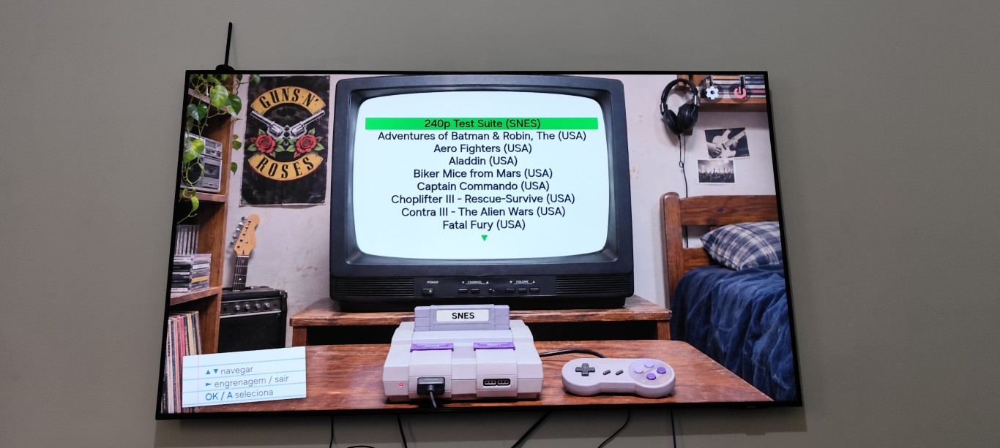
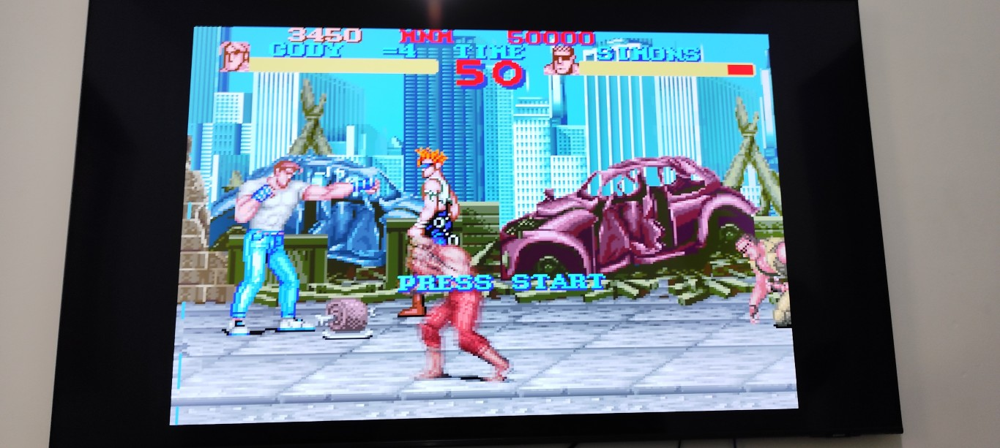
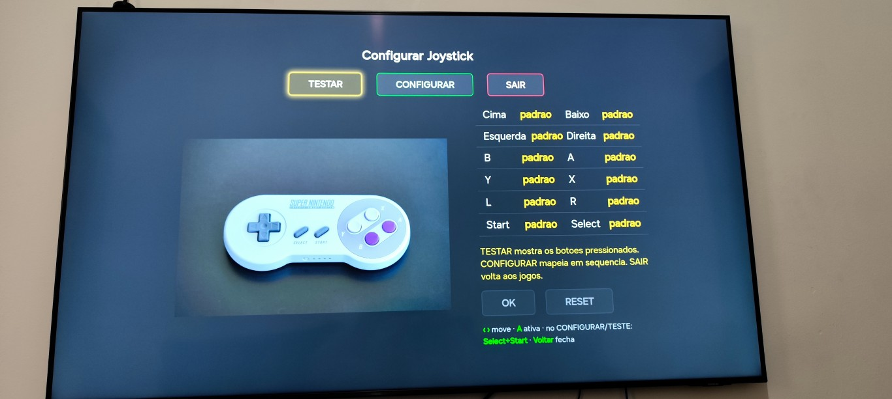
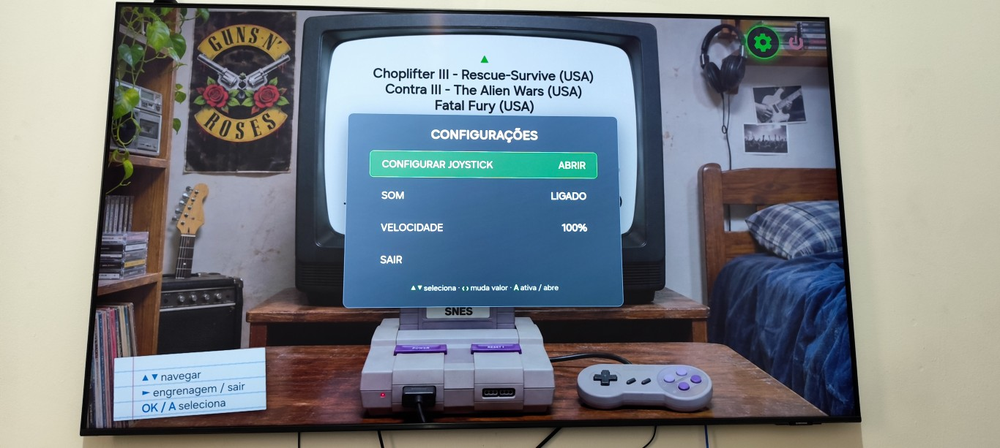
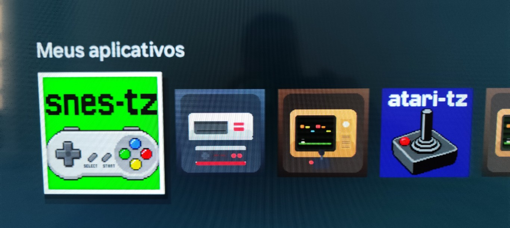

# 🎮 Emulador de SNES para Smart TV Samsung (Tizen)

Jogue **Super Nintendo (SNES)** na sua **Smart TV Samsung**. Um aplicativo web independente (`.wgt`) instalado por **sideload** na TV, rodando o núcleo **snes9x2005** compilado para **WebAssembly** em velocidade cheia no SoC modesto da TV. Abre pela tela inicial do [lilauncher](https://github.com/mendes79/lilauncher) ou direto pela lista de aplicativos da TV.

> Sem root. Sem binário nativo. Apenas a própria WebView da TV. Sem vínculo com a Nintendo ou a Samsung.

|  |  |
| :---: | :---: |
|  |  |
| _Jogo em velocidade cheia (snes9x2005 em WASM)_ | _Configuração interativa do joystick_ |
|  |  |
| _Configurações: som e presets de velocidade_ | _Abre pela tela inicial do lilauncher_ |

## ▶️ Demonstração

<!-- TODO: cole aqui o link do vídeo de demonstração no YouTube. Ex.: [Ver demo de 60s](https://youtu.be/SEU_VIDEO) -->
_Vídeo de demonstração em breve._

## Por que existe

As TVs Tizen da Samsung de 2022 trazem um motor web Chromium M85 travado, sem SIMD e sem threads no WebAssembly. A maioria das builds de emulador simplesmente não valida nem roda. Este projeto entrega uma **build enxuta de WebAssembly, single-thread e escalar** do snes9x2005 que roda em velocidade cheia nesse motor, dentro de uma interface pensada para a TV, controlada por gamepad.

## O que é

- Dispositivo alvo: Samsung 65BU8000 (2022, Crystal UHD), Tizen 6.5, motor web Chromium M85.
- Núcleo: snes9x2005 recompilado para um módulo WebAssembly enxuto, single-thread e escalar (sem SIMD, sem threads), para validar e rodar no antigo Chromium M85.
- Entregue como pacote Tizen `.wgt`. É a mesma WebView usada pelo navegador da TV, então não há binário nativo do lado do app.

## Recursos

- Emulação em velocidade cheia na TV alvo (validada com um medidor de velocidade honesto: quadros emulados por segundo real, não o FPS nominal).
- Tela de seleção de jogos sobre papel de parede temático, com navegação vertical e painel de configurações.
- Configurações: som ligado/desligado e presets de redução de velocidade (100%, -6%, -8%, -10%), salvos localmente.
- Configuração interativa do joystick: um assistente guiado mapeia cada botão, com um diagrama do controle que acende o botão pressionado.
- Controle: 8BitDo Ultimate 2.4G (dongle USB HID) via Gamepad API. Select+Start volta ao carrossel durante o jogo.
- Separação do catálogo: ROMs comerciais privadas ficam locais e nunca são publicadas; ROMs de livre distribuição ficam em `roms_pub/`.

## ROM livre inclusa

- 240p Test Suite (SNES), de Artemio Urbina, GNU GPL v2. Uma suíte de testes de vídeo que também serve como ROM de teste livre para o emulador. Veja `roms_pub/CREDITS.md`.

## Estrutura do repositório

- `index.html` mais `js/` : a aplicação (UI, entrada, áudio, HUD, adaptador de frontend libretro).
- `js/snes9x2005.wasm` / `js/snes9x2005.js` : o núcleo compilado.
- `core/` : registro de build do núcleo (build reproduzível com Emscripten 3.1.56).
- `img/` : papel de parede, ícone do app, diagrama do controle e overlays de destaque.
- `roms_pub/` : ROMs de livre distribuição (publicadas).
- `roms/`, `roms.json` : ROMs comerciais privadas e catálogo (git-ignored, não publicados).

## Instalação

### 1. Ative o Modo de Desenvolvedor na TV

1. Na tela de Apps, pressione `1 2 3 4 5` no controle.
2. Deixe o Modo de Desenvolvedor = ON.
3. Informe o IP do seu PC na rede em Host PC IP.
4. Reinicie a TV.

### 2. Monte, assine e instale o app

A Samsung assina cada app de TV com um certificado vinculado ao DUID daquela TV específica, então um `.wgt` pronto não pode ser compartilhado entre TVs. Com o Tizen Studio no Windows, crie um certificado Samsung com o DUID da sua TV, depois monte, assine e instale o app pela rede e abra. Essa configuração é feita uma vez só; as instalações seguintes são rápidas.

### 3. Adicione suas próprias ROMs

Coloque seus arquivos `.sfc` / `.smc` obtidos legalmente em uma pasta `roms/` ao lado de `index.html` e liste-os em `roms.json` (git-ignored, mantido privado), depois reinstale o app para que sejam empacotados no `.wgt`.

Precisa do passo a passo detalhado com telas? Veja o guia de instalação: [docs/INSTALACAO.md](docs/INSTALACAO.md) (inglês: [docs/INSTALL.md](docs/INSTALL.md)).

## Perguntas frequentes

**Funciona no meu modelo de TV Samsung?** Construído e testado em uma 65BU8000 (Tizen 6.5, 2022). Deve funcionar nas famílias BU e AU 8000 e em modelos Tizen 6.x próximos. Outros modelos não foram testados; relatos são bem-vindos em Issues.

**Dá pra instalar um `.wgt` pronto?** Não. A Samsung vincula a assinatura de cada app ao DUID da TV, então você monta e assina na sua própria TV. É uma configuração feita uma vez só.

**Isso é legal?** O código do emulador é MIT e não inclui nenhuma ROM com direitos autorais (apenas a 240p Test Suite, sob GPL). Você fornece suas próprias ROMs obtidas legalmente.

## Licença

- Código original da aplicação: MIT (veja LICENSE).
- Componentes de terceiros mantêm suas próprias licenças (veja THIRD-PARTY.md): o núcleo snes9x2005 sob a licença não comercial do Snes9x, e a 240p Test Suite sob GPL v2. Este projeto é livre e não comercial.

## Aviso Legal

Este projeto é um emulador independente e não oficial, desenvolvido apenas para fins educacionais.

- Este repositório não inclui nenhuma ROM com direitos autorais nem ativos proprietários. A única ROM incluída é a 240p Test Suite, de livre distribuição sob GPL v2.
- Os usuários devem fornecer suas próprias ROMs de SNES obtidas legalmente para jogar outros jogos. ROMs comerciais privadas ficam locais e nunca são publicadas.
- Este projeto não é afiliado, endossado nem associado à Nintendo ou ao Super Nintendo Entertainment System.
- Todas as marcas e marcas registradas são propriedade de seus respectivos donos.

## Créditos

- [Núcleo snes9x2005](https://github.com/libretro/snes9x2005): os autores do [Snes9x](https://github.com/snes9xgit/snes9x) e a equipe do [libretro](https://www.libretro.com/).
- [240p Test Suite](https://github.com/ArtemioUrbina/240pTestSuite): Artemio Urbina e colaboradores.
- Foto do controle: [Ravi Palwe no Unsplash](https://unsplash.com/photos/_Vrw58wU4aI) (Licença Unsplash).
- Harness de referência do GameBoy e o projeto [lilauncher](https://github.com/mendes79/lilauncher), no qual este emulador se encaixa.

## Projetos relacionados

- [lilauncher](https://github.com/mendes79/lilauncher) — a tela inicial personalizada da TV Samsung em que este emulador roda.
- [Atari 2600 Tizen Emulator](https://github.com/mendes79/Atari-2600-Tizen-Emulator) — mesma abordagem, núcleo de Atari 2600.
- [NES Tizen Emulator](https://github.com/mendes79/NES-Tizen-Emulator) — mesma abordagem, núcleo de NES (FCEUmm).
- [Videokê TV](https://github.com/mendes79/videoke-tv) — estação de karaokê para a TV, fila em tempo real pelo celular via QR Code, aberta pelo lilauncher.

Versão em inglês: veja [README.md](README.md).
